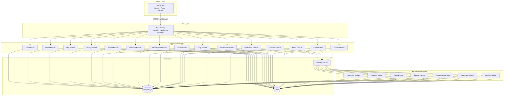
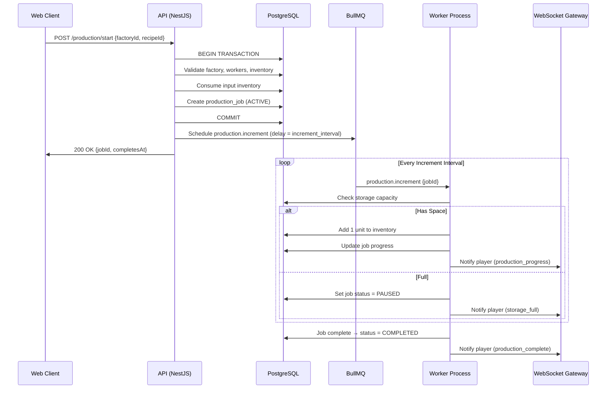
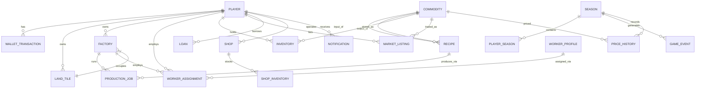

# Design Document: SEA Commodity Tycoon

## Overview

SEA Commodity Tycoon is a web-based multiplayer economic tycoon game where players produce, process, and trade commodities inspired by Southeast Asian supply chains. The system is built as a server-authoritative modular monolith with asynchronous workers, ensuring all economic calculations happen server-side for fairness and anti-cheat guarantees.

The design follows these core principles:
- **Server-authoritative**: The browser is a display layer; all mutations happen on the backend.
- **Data-driven economy**: Commodities, recipes, pricing, and economic parameters are loaded from configuration, not hard-coded.
- **Transactional integrity**: Every economic change is atomic and recorded in an append-only wallet ledger.
- **Event-driven simulation**: Production, seasons, market updates, and world events run via background jobs independent of player connectivity.
- **Directed production graph**: The commodity chain is a DAG of recipes, supporting forks, merges, and arbitrary depth.

### Key Design Decisions

| Decision | Rationale |
|----------|-----------|
| Modular monolith over microservices | Tightly coupled game systems (production → inventory → supply → prices) benefit from in-process transactions and simpler consistency |
| PostgreSQL as single source of truth | ACID transactions for economic integrity; transaction ledger pattern for auditability |
| Redis for ephemeral state only | WebSocket presence, rate limiting, cache — never authoritative for money/inventory |
| BullMQ for background jobs | Reliable job scheduling for production ticks, depreciation, pricing recalibration, and events |
| FIFO marketplace (no custom prices) | Simplifies MVP; all goods trade at the global dynamic price |
| Incremental production output | Units produced one-at-a-time during a production cycle rather than all-at-once at completion |

---

## Architecture

### High-Level System Diagram



### Monorepo Structure

```
/
├── apps/
│   ├── web/              # Next.js frontend
│   ├── api/              # NestJS backend API
│   ├── worker/           # BullMQ background workers
│   └── admin/            # Admin dashboard (React)
├── packages/
│   ├── game-rules/       # Commodity definitions, recipes, formulas
│   ├── shared-types/     # TypeScript interfaces shared across apps
│   ├── ui/               # Shared UI component library
│   └── config/           # Environment and game configuration
├── docker-compose.yml
├── turbo.json
└── package.json
```

### Module Interaction Flow (Production Example)



### Real-Time Communication Architecture

```mermaid
graph LR
    subgraph "WebSocket Channels"
        GLOBAL[global:announcements]
        PLAYER_CH[player:{id}:notifications]
        MKT_CH[marketplace:{commodity}:updates]
        SEASON_CH[season:events]
    end

    subgraph "Publishers"
        PRODW2[Production Worker]
        ECONW2[Economy Worker]
        EVENTW2[Event Worker]
        MKTMOD[Marketplace Module]
    end

    PRODW2 --> PLAYER_CH
    ECONW2 --> MKT_CH
    EVENTW2 --> GLOBAL & SEASON_CH
    MKTMOD --> MKT_CH & PLAYER_CH
```

---

## Components and Interfaces

### Shared Types and Enums

```typescript
enum TerrainType {
  WATER_TERRAIN = 'WATER_TERRAIN',
  FERTILE_SOIL = 'FERTILE_SOIL',
  FARMLAND = 'FARMLAND',
  MOUNTAIN = 'MOUNTAIN',
  CITY = 'CITY',
}

enum CommodityCategory {
  AGRICULTURE = 'AGRICULTURE',
  ENERGY = 'ENERGY',
  METAL = 'METAL',
  LIVESTOCK = 'LIVESTOCK',
  FISHERY = 'FISHERY',
  FORESTRY = 'FORESTRY',
  ELECTRONICS = 'ELECTRONICS',
  AUTOMOTIVE = 'AUTOMOTIVE',
}

enum FactoryStatus {
  IDLE = 'IDLE',
  PRODUCING = 'PRODUCING',
  PAUSED = 'PAUSED',
}

enum WorkerStatus {
  UNASSIGNED = 'UNASSIGNED',
  WORKING = 'WORKING',
  ABSENT = 'ABSENT',
  SICK = 'SICK',
  ON_VACATION = 'ON_VACATION',
}
```

### Backend Module Interfaces

#### Auth Module
```typescript
interface AuthModule {
  register(email: string, provider: 'email' | 'google'): Promise<Player>;
  login(credentials: LoginDto): Promise<{ accessToken: string; player: Player }>;
  validateSession(token: string): Promise<Player>;
}
```

#### Player Module
```typescript
interface PlayerModule {
  createProfile(playerId: string, dto: CreateProfileDto): Promise<PlayerProfile>;
  selectSpecialty(playerId: string, seasonId: string, category: CommodityCategory): Promise<void>;
  getPlayerState(playerId: string): Promise<PlayerState>;
  getNetWorth(playerId: string): Promise<NetWorthBreakdown>;
  updateLastActiveAt(playerId: string): Promise<void>;
}
```

#### Map Module
```typescript
interface MapModule {
  generateMap(seasonId: string, config: MapConfig): Promise<GameMap>;
  getTiles(regionBounds: BoundingBox): Promise<Tile[]>;
  purchaseTiles(playerId: string, tileIds: string[]): Promise<LandPurchaseResult>;
  // purchaseTiles enforces: if any tile has terrain_type = CITY AND season.starts_at + 5 days > NOW(), reject purchase.
  // CITY tiles are locked from purchase for the first 5 days of a season (available starting Day 6).
  validateTerrain(tileIds: string[], category: CommodityCategory): Promise<TerrainValidation>; // Rejects CITY terrain for all factory categories
  resellTiles(playerId: string, tileIds: string[]): Promise<LandResaleResult>;
}
```

#### Factory Module
```typescript
interface FactoryModule {
  construct(playerId: string, dto: ConstructFactoryDto): Promise<Factory>; // Rejects construction on CITY terrain tiles
  deconstruct(playerId: string, factoryId: string): Promise<DeconstructResult>;
  performMaintenance(playerId: string, factoryId: string): Promise<MaintenanceResult>;
  getEfficiency(factoryId: string): Promise<EfficiencyInfo>;
  applyDepreciationTick(factoryId: string): Promise<void>;
  switchOutput(playerId: string, factoryId: string, newOutputSlug: string): Promise<void>; // Switch exclusive output (Poultry/Cattle/Fish), enforces 72h cooldown
}
```

#### Worker Module
```typescript
interface WorkerModule {
  getAvailableWorkers(filters?: WorkerFilters): Promise<WorkerProfile[]>;
  hire(playerId: string, workerId: string, factoryId: string): Promise<void>;
  fire(playerId: string, workerId: string): Promise<void>;
  reassign(playerId: string, workerId: string, newFactoryId: string): Promise<void>;
  triggerDisruption(workerId: string, type: 'ABSENT' | 'SICK'): Promise<void>;
  resolveDisruption(workerId: string): Promise<void>;
}
```

#### Production Module
```typescript
interface ProductionModule {
  startProduction(playerId: string, dto: StartProductionDto): Promise<ProductionJob>;
  pauseProduction(jobId: string, reason: PauseReason): Promise<void>;
  resumeProduction(jobId: string): Promise<void>;
  processIncrement(jobId: string): Promise<IncrementResult>;
  calculateYield(factoryId: string, recipeId: string): Promise<YieldCalculation>;
  applyFertilizer(playerId: string, factoryId: string): Promise<FertilizerResult>;
}
```

#### Marketplace Module
```typescript
interface MarketplaceModule {
  listForSale(playerId: string, dto: ListItemDto): Promise<MarketListing>;
  purchase(playerId: string, dto: PurchaseDto): Promise<TradeResult>;
  cancelListing(playerId: string, listingId: string): Promise<void>;
  instantSell(playerId: string, dto: InstantSellDto): Promise<InstantSellResult>;
  getQueueDepth(commodityId: string): Promise<QueueInfo>;
  getMarketPrice(commodityId: string): Promise<PriceInfo>;
}
```

#### Economy Module
```typescript
interface EconomyModule {
  recalibratePrices(seasonId: string): Promise<PriceRecalibrationResult>;
  getSupplyMetrics(commodityId: string): Promise<SupplyMetrics>;
  getDemandMetrics(commodityId: string): Promise<DemandMetrics>;
  getPriceHistory(commodityId: string, range: DateRange): Promise<PricePoint[]>;
}
```

#### Bank Module
```typescript
interface BankModule {
  requestLoan(playerId: string, dto: LoanRequestDto): Promise<Loan>;
  processInstallment(loanId: string): Promise<InstallmentResult>;
  repayEarly(playerId: string, loanId: string, amount: number): Promise<RepaymentResult>;
  getMaxBorrowingCapacity(playerId: string): Promise<number>;
  getActiveLoans(playerId: string): Promise<Loan[]>;
}
```

#### Shop Module
```typescript
// All shops require exactly 1 CITY terrain tile.
interface ShopModule {
  construct(playerId: string, dto: ConstructShopDto): Promise<Shop>; // Validates player owns the specified CITY tile and it is unoccupied
  deconstruct(playerId: string, shopId: string): Promise<DeconstructResult>; // 25% fee of setup cost, releases CITY tile back to player
  stockShop(playerId: string, shopId: string, commodityId: string, quantity: number): Promise<void>;
  processConsumption(shopId: string): Promise<ConsumptionResult>;
  getRevenue(shopId: string, range?: DateRange): Promise<RevenueInfo>;
}
```

#### Season Module
```typescript
interface SeasonModule {
  startSeason(config: SeasonConfig): Promise<Season>;
  endSeason(seasonId: string): Promise<SeasonSummary>;
  getCurrentSeason(): Promise<Season>;
  generateSummary(seasonId: string): Promise<SeasonSummary>;
}
```

#### Event Module
```typescript
interface EventModule {
  triggerEvent(dto: TriggerEventDto): Promise<GameEvent>;
  endEvent(eventId: string): Promise<void>;
  getActiveEvents(): Promise<GameEvent[]>;
  getActiveModifiers(commodityCategory: CommodityCategory): Promise<Modifier[]>;
}
```

#### Notification Module
```typescript
interface NotificationModule {
  sendToPlayer(playerId: string, notification: Notification): Promise<void>;
  broadcast(notification: Notification): Promise<void>;
  getQueuedNotifications(playerId: string): Promise<Notification[]>;
  markAsRead(playerId: string, notificationIds: string[]): Promise<void>;
}
```

### REST API Endpoints

#### Authentication
| Method | Path | Description |
|--------|------|-------------|
| POST | /auth/register | Register new player |
| POST | /auth/login | Login (email/Google) |
| POST | /auth/refresh | Refresh access token |

#### Player
| Method | Path | Description |
|--------|------|-------------|
| GET | /players/me | Get current player state |
| PUT | /players/me/profile | Update avatar/display name |
| POST | /players/me/specialty | Select season specialty |
| GET | /players/me/net-worth | Get net worth breakdown |
| GET | /players/me/dashboard | Get full dashboard stats |

#### Map & Land
| Method | Path | Description |
|--------|------|-------------|
| GET | /map/tiles | Get tiles in viewport |
| POST | /map/tiles/purchase | Purchase a group of tiles |
| POST | /map/tiles/resell | Resell owned tiles |
| GET | /map/tiles/validate | Validate terrain for category |

#### Factory
| Method | Path | Description |
|--------|------|-------------|
| POST | /factories | Construct a factory |
| GET | /factories | List player's factories |
| GET | /factories/:id | Get factory details |
| DELETE | /factories/:id | Deconstruct factory |
| POST | /factories/:id/maintenance | Perform maintenance |
| POST | /factories/:id/fertilizer | Apply fertilizer |
| POST | /factories/:id/switch-output | Switch exclusive output recipe |

#### Workers
| Method | Path | Description |
|--------|------|-------------|
| GET | /workers/available | List available workers |
| POST | /workers/:id/hire | Hire a worker |
| POST | /workers/:id/fire | Fire a worker |
| POST | /workers/:id/reassign | Reassign worker |
| GET | /workers/mine | List player's workers |

#### Production
| Method | Path | Description |
|--------|------|-------------|
| POST | /production/start | Start a production job |
| GET | /production/jobs | List active production jobs |
| GET | /production/jobs/:id | Get job status |

#### Inventory & Storage
| Method | Path | Description |
|--------|------|-------------|
| GET | /inventory | Get player inventory |
| POST | /inventory/storage/upgrade | Upgrade storage tier |

#### Marketplace
| Method | Path | Description |
|--------|------|-------------|
| GET | /marketplace/:commodityId | Get commodity queue info |
| POST | /marketplace/list | List inventory for sale |
| POST | /marketplace/buy | Buy from marketplace |
| DELETE | /marketplace/listings/:id | Cancel listing |
| POST | /marketplace/instant-sell | Instant sell to bank |
| GET | /marketplace/prices | Get all current prices |

#### Bank
| Method | Path | Description |
|--------|------|-------------|
| POST | /bank/loans | Request a loan |
| GET | /bank/loans | List active loans |
| POST | /bank/loans/:id/repay | Early repayment |
| GET | /bank/capacity | Get borrowing capacity |

#### Shops
| Method | Path | Description |
|--------|------|-------------|
| POST | /shops | Construct a shop (body includes `tileId` for CITY tile) |
| GET | /shops | List player's shops |
| DELETE | /shops/:id | Deconstruct shop (25% fee, releases CITY tile) |
| POST | /shops/:id/stock | Stock shop inventory |
| GET | /shops/:id/revenue | Get shop revenue |

#### Economy & Prices
| Method | Path | Description |
|--------|------|-------------|
| GET | /economy/prices/:commodityId/history | Price history |
| GET | /economy/leaderboard | Season leaderboard |

#### Workforce Happiness
| Method | Path | Description |
|--------|------|-------------|
| GET | /happiness | Get current happiness |
| POST | /happiness/boost | Purchase a happiness boost |
| GET | /happiness/boosts | List available boosts |

#### Season
| Method | Path | Description |
|--------|------|-------------|
| GET | /season/current | Get current season info |
| GET | /season/summary/:id | Get season summary |
| GET | /season/history | List past seasons |

#### Admin
| Method | Path | Description |
|--------|------|-------------|
| POST | /admin/simulation/run | Run recipe simulation |
| GET | /admin/simulation/results/:id | Get simulation results |
| PUT | /admin/config/commodities | Update commodity config |
| PUT | /admin/config/recipes | Update recipe config |
| POST | /admin/events/trigger | Manually trigger event |
| POST | /admin/season/start | Start new season |
| POST | /admin/season/end | End current season |

### WebSocket Events

#### Server → Client
| Event | Channel | Payload |
|-------|---------|---------|
| `production.progress` | player:{id} | `{ jobId, unitsProduced, totalYield }` |
| `production.complete` | player:{id} | `{ jobId, commodityId, totalProduced }` |
| `production.paused` | player:{id} | `{ jobId, reason }` |
| `marketplace.trade` | marketplace:{commodity} | `{ commodityId, quantity, price, queueDepth }` |
| `marketplace.price_update` | marketplace:{commodity} | `{ commodityId, newPrice, change }` |
| `worker.status_change` | player:{id} | `{ workerId, oldStatus, newStatus }` |
| `event.started` | global | `{ eventId, type, affectedCategories, modifiers }` |
| `event.ended` | global | `{ eventId }` |
| `season.milestone` | global | `{ type, message }` |
| `notification` | player:{id} | `{ id, type, title, body, priority }` |
| `loan.payment_reminder` | player:{id} | `{ loanId, amount, dueAt }` |
| `shop.revenue` | player:{id} | `{ shopId, amount, commodityConsumed }` |
| `factory.output_switched` | player:{id} | `{ factoryId, oldOutput, newOutput, cooldownUntil }` |
| `happiness.warning` | player:{id} | `{ level, currentHappiness }` |

#### Client → Server
| Event | Payload |
|-------|---------|
| `subscribe` | `{ channels: string[] }` |
| `unsubscribe` | `{ channels: string[] }` |
| `heartbeat` | `{ timestamp }` |

### Background Job Definitions (BullMQ)

| Queue | Job Name | Schedule/Trigger | Description |
|-------|----------|------------------|-------------|
| production | `production.increment` | Delayed (increment_interval) | Produces one unit of output |
| production | `production.check_resume` | On inventory change | Checks if paused jobs can resume |
| economy | `economy.recalibrate` | Cron: daily midnight GMT+8 | Recalculates all commodity prices |
| economy | `economy.snapshot` | Cron: every hour | Records price/volume snapshots |
| depreciation | `factory.depreciation_tick` | Cron: every 5 game days | Reduces factory efficiency |
| happiness | `happiness.daily_decay` | Cron: daily | Reduces all players' happiness by 1% |
| worker | `worker.disruption_check` | Cron: every 4 hours | Rolls for worker absence/sickness |
| worker | `worker.salary_deduction` | Cron: daily | Deducts worker salaries |
| bank | `loan.installment` | Scheduled per loan | Processes loan payment |
| shop | `shop.consumption` | Cron: hourly | Processes shop inventory consumption |
| season | `season.end` | Scheduled | Ends current season |
| season | `season.summary` | On season end | Generates season summary |
| events | `event.trigger` | Random schedule | Triggers random economic events |
| events | `event.end` | Scheduled per event | Ends an active event |
| fertilizer | `fertilizer.expire` | Scheduled per boost | Expires fertilizer boost |
| fertilizer | `fertilizer.auto_reapply` | On expiry | Attempts automatic reapplication |
| inactivity | `player.inactivity_check` | Cron: daily | Sends reminder emails |

---

## Data Models

### Entity Relationship Diagram



### PostgreSQL Schema

```sql
-- ============================================================
-- CORE ENTITIES
-- ============================================================

CREATE TABLE seasons (
    id UUID PRIMARY KEY DEFAULT gen_random_uuid(),
    starts_at TIMESTAMPTZ NOT NULL,
    ends_at TIMESTAMPTZ NOT NULL,
    status VARCHAR(20) NOT NULL DEFAULT 'PENDING', -- PENDING, ACTIVE, ENDED
    configuration JSONB NOT NULL DEFAULT '{}',
    map_seed BIGINT NOT NULL,
    summary JSONB, -- populated on season end
    created_at TIMESTAMPTZ NOT NULL DEFAULT NOW()
);

CREATE TABLE players (
    id UUID PRIMARY KEY DEFAULT gen_random_uuid(),
    email VARCHAR(255) UNIQUE NOT NULL,
    auth_provider VARCHAR(20) NOT NULL, -- 'email', 'google'
    auth_provider_id VARCHAR(255),
    display_name VARCHAR(50) UNIQUE NOT NULL,
    avatar_config JSONB NOT NULL DEFAULT '{}',
    created_at TIMESTAMPTZ NOT NULL DEFAULT NOW(),
    last_active_at TIMESTAMPTZ NOT NULL DEFAULT NOW()
);

CREATE TABLE player_seasons (
    id UUID PRIMARY KEY DEFAULT gen_random_uuid(),
    player_id UUID NOT NULL REFERENCES players(id),
    season_id UUID NOT NULL REFERENCES seasons(id),
    specialty VARCHAR(50), -- commodity category chosen
    coins DECIMAL(15, 2) NOT NULL DEFAULT 1000.00,
    storage_capacity INT NOT NULL DEFAULT 500,
    workforce_happiness DECIMAL(5, 2) NOT NULL DEFAULT 80.00,
    last_happiness_decay_at TIMESTAMPTZ,
    inactivity_reminder_sent BOOLEAN NOT NULL DEFAULT FALSE,
    created_at TIMESTAMPTZ NOT NULL DEFAULT NOW(),
    UNIQUE(player_id, season_id)
);

CREATE INDEX idx_player_seasons_player ON player_seasons(player_id);
CREATE INDEX idx_player_seasons_season ON player_seasons(season_id);

-- ============================================================
-- MAP & LAND
-- ============================================================

CREATE TABLE map_tiles (
    id UUID PRIMARY KEY DEFAULT gen_random_uuid(),
    season_id UUID NOT NULL REFERENCES seasons(id),
    x INT NOT NULL,
    y INT NOT NULL,
    terrain_type VARCHAR(20) NOT NULL, -- WATER, MOUNTAIN, FERTILE_SOIL, FARMLAND, CITY
    owner_player_id UUID REFERENCES players(id),
    factory_id UUID, -- set when a factory occupies this tile
    purchased_at TIMESTAMPTZ,
    purchase_price DECIMAL(10, 2),
    UNIQUE(season_id, x, y)
);

CREATE INDEX idx_map_tiles_season_owner ON map_tiles(season_id, owner_player_id);
CREATE INDEX idx_map_tiles_season_terrain ON map_tiles(season_id, terrain_type);
CREATE INDEX idx_map_tiles_factory ON map_tiles(factory_id);

-- ============================================================
-- COMMODITIES & RECIPES (Configuration)
-- ============================================================

CREATE TABLE commodities (
    id UUID PRIMARY KEY DEFAULT gen_random_uuid(),
    name VARCHAR(100) NOT NULL,
    slug VARCHAR(100) UNIQUE NOT NULL,
    category VARCHAR(50) NOT NULL, -- AGRICULTURE, ENERGY, METAL, LIVESTOCK, FORESTRY
    level INT NOT NULL DEFAULT 0, -- 0, 1, 2
    base_price DECIMAL(10, 2) NOT NULL,
    base_production_time_minutes INT NOT NULL,
    base_yield INT NOT NULL,
    storage_size INT NOT NULL DEFAULT 1,
    max_workers INT NOT NULL DEFAULT 2,
    terrain_requirement VARCHAR(20), -- required terrain type
    land_layout VARCHAR(10), -- e.g. '3x3', '3x2', '2x2'
    setup_cost DECIMAL(10, 2),
    metadata JSONB NOT NULL DEFAULT '{}',
    active BOOLEAN NOT NULL DEFAULT TRUE
);

CREATE TABLE recipes (
    id UUID PRIMARY KEY DEFAULT gen_random_uuid(),
    name VARCHAR(100) NOT NULL,
    slug VARCHAR(100) UNIQUE NOT NULL,
    processing_time_minutes INT NOT NULL,
    worker_requirement INT NOT NULL DEFAULT 1,
    output_commodity_id UUID NOT NULL REFERENCES commodities(id),
    output_quantity INT NOT NULL DEFAULT 1,
    factory_category VARCHAR(50) NOT NULL,
    metadata JSONB NOT NULL DEFAULT '{}',
    active BOOLEAN NOT NULL DEFAULT TRUE
);

CREATE TABLE recipe_inputs (
    id UUID PRIMARY KEY DEFAULT gen_random_uuid(),
    recipe_id UUID NOT NULL REFERENCES recipes(id) ON DELETE CASCADE,
    commodity_id UUID NOT NULL REFERENCES commodities(id),
    quantity INT NOT NULL DEFAULT 1
);

CREATE INDEX idx_recipe_inputs_recipe ON recipe_inputs(recipe_id);

-- ============================================================
-- FACTORIES
-- ============================================================

CREATE TABLE factories (
    id UUID PRIMARY KEY DEFAULT gen_random_uuid(),
    player_id UUID NOT NULL REFERENCES players(id),
    season_id UUID NOT NULL REFERENCES seasons(id),
    commodity_id UUID REFERENCES commodities(id), -- L0 factory
    recipe_id UUID REFERENCES recipes(id), -- processing factory
    category VARCHAR(50) NOT NULL,
    factory_level INT NOT NULL DEFAULT 0, -- 0=production, 1=processing, 2=assembly
    status VARCHAR(20) NOT NULL DEFAULT 'IDLE', -- IDLE, PRODUCING, PAUSED
    efficiency DECIMAL(5, 2) NOT NULL DEFAULT 100.00,
    maintenance_count INT NOT NULL DEFAULT 0,
    setup_cost DECIMAL(10, 2) NOT NULL,
    last_depreciation_at TIMESTAMPTZ,
    fertilizer_boost_active BOOLEAN NOT NULL DEFAULT FALSE,
    fertilizer_boost_expires_at TIMESTAMPTZ,
    exclusive_output_slug VARCHAR(100), -- for Poultry/Cattle/Fish factories (exclusive output selection)
    output_switch_cooldown_until TIMESTAMPTZ, -- 72h cooldown after switching exclusive output
    constructed_at TIMESTAMPTZ NOT NULL DEFAULT NOW()
);

CREATE INDEX idx_factories_player_season ON factories(player_id, season_id);

-- ============================================================
-- WORKERS
-- ============================================================

CREATE TABLE worker_profiles (
    id UUID PRIMARY KEY DEFAULT gen_random_uuid(),
    name VARCHAR(100) NOT NULL,
    age INT NOT NULL,
    gender VARCHAR(10) NOT NULL,
    specialty VARCHAR(50) NOT NULL, -- commodity category specialty
    salary DECIMAL(10, 2) NOT NULL,
    experience_level INT NOT NULL CHECK (experience_level BETWEEN 1 AND 5),
    commitment_level DECIMAL(5, 2) NOT NULL CHECK (commitment_level BETWEEN 70 AND 100),
    season_id UUID NOT NULL REFERENCES seasons(id),
    unlocked BOOLEAN NOT NULL DEFAULT FALSE
);

CREATE TABLE worker_assignments (
    id UUID PRIMARY KEY DEFAULT gen_random_uuid(),
    worker_id UUID NOT NULL REFERENCES worker_profiles(id),
    player_id UUID NOT NULL REFERENCES players(id),
    factory_id UUID REFERENCES factories(id),
    season_id UUID NOT NULL REFERENCES seasons(id),
    status VARCHAR(20) NOT NULL DEFAULT 'WORKING', -- UNASSIGNED, WORKING, ABSENT, SICK, ON_VACATION
    hired_at TIMESTAMPTZ NOT NULL DEFAULT NOW(),
    status_changed_at TIMESTAMPTZ,
    disruption_ends_at TIMESTAMPTZ
);

CREATE INDEX idx_worker_assignments_player ON worker_assignments(player_id, season_id);
CREATE INDEX idx_worker_assignments_factory ON worker_assignments(factory_id);

-- ============================================================
-- PRODUCTION
-- ============================================================

CREATE TABLE production_jobs (
    id UUID PRIMARY KEY DEFAULT gen_random_uuid(),
    player_id UUID NOT NULL REFERENCES players(id),
    factory_id UUID NOT NULL REFERENCES factories(id),
    recipe_id UUID REFERENCES recipes(id), -- NULL for L0 production
    commodity_id UUID NOT NULL REFERENCES commodities(id), -- output commodity
    season_id UUID NOT NULL REFERENCES seasons(id),
    status VARCHAR(20) NOT NULL DEFAULT 'ACTIVE', -- ACTIVE, PAUSED, COMPLETED, CANCELLED
    base_yield INT NOT NULL,
    final_yield INT NOT NULL,
    units_produced INT NOT NULL DEFAULT 0,
    increment_interval_minutes INT NOT NULL,
    effective_production_time_minutes INT NOT NULL,
    started_at TIMESTAMPTZ NOT NULL DEFAULT NOW(),
    paused_at TIMESTAMPTZ,
    completes_at TIMESTAMPTZ NOT NULL,
    completed_at TIMESTAMPTZ,
    pause_reason VARCHAR(50), -- STORAGE_FULL, WORKER_ABSENT
    input_snapshot JSONB, -- what was consumed
    yield_modifiers JSONB NOT NULL DEFAULT '{}' -- breakdown of applied modifiers
);

CREATE INDEX idx_production_jobs_player ON production_jobs(player_id, season_id);
CREATE INDEX idx_production_jobs_factory ON production_jobs(factory_id);
CREATE INDEX idx_production_jobs_status ON production_jobs(status);

-- ============================================================
-- INVENTORY
-- ============================================================

CREATE TABLE inventory (
    id UUID PRIMARY KEY DEFAULT gen_random_uuid(),
    player_id UUID NOT NULL REFERENCES players(id),
    season_id UUID NOT NULL REFERENCES seasons(id),
    commodity_id UUID NOT NULL REFERENCES commodities(id),
    quantity INT NOT NULL DEFAULT 0 CHECK (quantity >= 0),
    UNIQUE(player_id, season_id, commodity_id)
);

CREATE INDEX idx_inventory_player_season ON inventory(player_id, season_id);

-- ============================================================
-- MARKETPLACE
-- ============================================================

CREATE TABLE market_listings (
    id UUID PRIMARY KEY DEFAULT gen_random_uuid(),
    player_id UUID NOT NULL REFERENCES players(id),
    season_id UUID NOT NULL REFERENCES seasons(id),
    commodity_id UUID NOT NULL REFERENCES commodities(id),
    quantity INT NOT NULL CHECK (quantity > 0),
    remaining_quantity INT NOT NULL CHECK (remaining_quantity >= 0),
    listed_at TIMESTAMPTZ NOT NULL DEFAULT NOW(),
    status VARCHAR(20) NOT NULL DEFAULT 'ACTIVE', -- ACTIVE, FILLED, CANCELLED
    filled_at TIMESTAMPTZ,
    cancelled_at TIMESTAMPTZ
);

CREATE INDEX idx_market_listings_commodity_fifo ON market_listings(commodity_id, season_id, listed_at)
    WHERE status = 'ACTIVE';
CREATE INDEX idx_market_listings_player ON market_listings(player_id, season_id);

CREATE TABLE market_trades (
    id UUID PRIMARY KEY DEFAULT gen_random_uuid(),
    season_id UUID NOT NULL REFERENCES seasons(id),
    listing_id UUID NOT NULL REFERENCES market_listings(id),
    buyer_id UUID NOT NULL REFERENCES players(id),
    seller_id UUID NOT NULL REFERENCES players(id),
    commodity_id UUID NOT NULL REFERENCES commodities(id),
    quantity INT NOT NULL,
    price_per_unit DECIMAL(10, 2) NOT NULL,
    total_price DECIMAL(15, 2) NOT NULL,
    traded_at TIMESTAMPTZ NOT NULL DEFAULT NOW()
);

CREATE INDEX idx_market_trades_season_commodity ON market_trades(season_id, commodity_id);

-- ============================================================
-- PRICING
-- ============================================================

CREATE TABLE commodity_prices (
    id UUID PRIMARY KEY DEFAULT gen_random_uuid(),
    season_id UUID NOT NULL REFERENCES seasons(id),
    commodity_id UUID NOT NULL REFERENCES commodities(id),
    price DECIMAL(10, 2) NOT NULL,
    supply_multiplier DECIMAL(8, 4) NOT NULL DEFAULT 1.0000,
    demand_multiplier DECIMAL(8, 4) NOT NULL DEFAULT 1.0000,
    supply_metric DECIMAL(15, 2),
    demand_metric DECIMAL(15, 2),
    trade_volume INT NOT NULL DEFAULT 0,
    recorded_at TIMESTAMPTZ NOT NULL DEFAULT NOW()
);

CREATE INDEX idx_commodity_prices_lookup ON commodity_prices(season_id, commodity_id, recorded_at DESC);

-- Current price cache (single row per commodity per season)
CREATE TABLE current_prices (
    season_id UUID NOT NULL REFERENCES seasons(id),
    commodity_id UUID NOT NULL REFERENCES commodities(id),
    price DECIMAL(10, 2) NOT NULL,
    supply_multiplier DECIMAL(8, 4) NOT NULL DEFAULT 1.0000,
    demand_multiplier DECIMAL(8, 4) NOT NULL DEFAULT 1.0000,
    last_updated_at TIMESTAMPTZ NOT NULL DEFAULT NOW(),
    PRIMARY KEY (season_id, commodity_id)
);

-- ============================================================
-- BANK & LOANS
-- ============================================================

CREATE TABLE loans (
    id UUID PRIMARY KEY DEFAULT gen_random_uuid(),
    player_id UUID NOT NULL REFERENCES players(id),
    season_id UUID NOT NULL REFERENCES seasons(id),
    principal DECIMAL(15, 2) NOT NULL,
    outstanding_balance DECIMAL(15, 2) NOT NULL,
    interest_rate DECIMAL(5, 4) NOT NULL DEFAULT 0.0500, -- 5%
    installment_interval_days INT NOT NULL DEFAULT 5,
    max_duration_days INT NOT NULL DEFAULT 20,
    status VARCHAR(20) NOT NULL DEFAULT 'ACTIVE', -- ACTIVE, PAID, DEFAULTED
    next_installment_at TIMESTAMPTZ NOT NULL,
    disbursed_at TIMESTAMPTZ NOT NULL DEFAULT NOW(),
    paid_at TIMESTAMPTZ,
    late_payment_count INT NOT NULL DEFAULT 0
);

CREATE INDEX idx_loans_player_season ON loans(player_id, season_id);
CREATE INDEX idx_loans_next_installment ON loans(next_installment_at) WHERE status = 'ACTIVE';

CREATE TABLE loan_payments (
    id UUID PRIMARY KEY DEFAULT gen_random_uuid(),
    loan_id UUID NOT NULL REFERENCES loans(id),
    amount DECIMAL(15, 2) NOT NULL,
    principal_portion DECIMAL(15, 2) NOT NULL,
    interest_portion DECIMAL(15, 2) NOT NULL,
    penalty_amount DECIMAL(15, 2) NOT NULL DEFAULT 0,
    payment_type VARCHAR(20) NOT NULL, -- SCHEDULED, EARLY, LATE
    paid_at TIMESTAMPTZ NOT NULL DEFAULT NOW()
);

-- ============================================================
-- SHOPS
-- ============================================================

CREATE TABLE shops (
    id UUID PRIMARY KEY DEFAULT gen_random_uuid(),
    player_id UUID NOT NULL REFERENCES players(id),
    season_id UUID NOT NULL REFERENCES seasons(id),
    tile_id UUID NOT NULL REFERENCES map_tiles(id), -- must be a CITY terrain tile
    shop_type VARCHAR(50) NOT NULL, -- SUPERMARKET, BUTCHER, CAFE, PETROL_STATION, FURNITURE, ELECTRONICS, CAR_STORE
    level INT NOT NULL DEFAULT 1,
    storage_capacity INT NOT NULL,
    demand_rate DECIMAL(10, 2) NOT NULL, -- units consumed per tick
    constructed_at TIMESTAMPTZ NOT NULL DEFAULT NOW()
);

CREATE TABLE shop_inventory (
    id UUID PRIMARY KEY DEFAULT gen_random_uuid(),
    shop_id UUID NOT NULL REFERENCES shops(id),
    commodity_id UUID NOT NULL REFERENCES commodities(id),
    quantity INT NOT NULL DEFAULT 0 CHECK (quantity >= 0),
    UNIQUE(shop_id, commodity_id)
);

CREATE TABLE shop_accepted_commodities (
    shop_type VARCHAR(50) NOT NULL,
    commodity_id UUID NOT NULL REFERENCES commodities(id),
    min_types_required INT NOT NULL DEFAULT 1,
    PRIMARY KEY (shop_type, commodity_id)
);

-- ============================================================
-- EVENTS
-- ============================================================

CREATE TABLE game_events (
    id UUID PRIMARY KEY DEFAULT gen_random_uuid(),
    season_id UUID NOT NULL REFERENCES seasons(id),
    event_type VARCHAR(50) NOT NULL,
    name VARCHAR(100) NOT NULL,
    description TEXT,
    starts_at TIMESTAMPTZ NOT NULL,
    ends_at TIMESTAMPTZ NOT NULL,
    affected_categories TEXT[] NOT NULL DEFAULT '{}',
    production_modifier DECIMAL(5, 2) DEFAULT 0, -- e.g., -0.30 for -30%
    demand_modifier DECIMAL(5, 2) DEFAULT 0,
    price_modifier DECIMAL(5, 2) DEFAULT 0,
    status VARCHAR(20) NOT NULL DEFAULT 'SCHEDULED', -- SCHEDULED, ACTIVE, ENDED
    metadata JSONB NOT NULL DEFAULT '{}'
);

CREATE INDEX idx_game_events_season_status ON game_events(season_id, status);

-- ============================================================
-- WALLET LEDGER
-- ============================================================

CREATE TABLE wallet_transactions (
    id UUID PRIMARY KEY DEFAULT gen_random_uuid(),
    player_id UUID NOT NULL REFERENCES players(id),
    season_id UUID NOT NULL REFERENCES seasons(id),
    transaction_type VARCHAR(50) NOT NULL,
    amount DECIMAL(15, 2) NOT NULL, -- positive = credit, negative = debit
    balance_after DECIMAL(15, 2) NOT NULL,
    reference_type VARCHAR(50),
    reference_id UUID,
    description TEXT,
    created_at TIMESTAMPTZ NOT NULL DEFAULT NOW()
);

CREATE INDEX idx_wallet_transactions_player_season ON wallet_transactions(player_id, season_id, created_at DESC);

-- ============================================================
-- NOTIFICATIONS
-- ============================================================

CREATE TABLE notifications (
    id UUID PRIMARY KEY DEFAULT gen_random_uuid(),
    player_id UUID NOT NULL REFERENCES players(id),
    season_id UUID NOT NULL REFERENCES seasons(id),
    type VARCHAR(50) NOT NULL,
    title VARCHAR(200) NOT NULL,
    body TEXT,
    priority VARCHAR(20) NOT NULL DEFAULT 'NORMAL', -- LOW, NORMAL, HIGH
    read BOOLEAN NOT NULL DEFAULT FALSE,
    delivered BOOLEAN NOT NULL DEFAULT FALSE,
    created_at TIMESTAMPTZ NOT NULL DEFAULT NOW()
);

CREATE INDEX idx_notifications_player_unread ON notifications(player_id, season_id, created_at DESC)
    WHERE read = FALSE;

-- ============================================================
-- SIMULATION (Admin)
-- ============================================================

CREATE TABLE simulation_runs (
    id UUID PRIMARY KEY DEFAULT gen_random_uuid(),
    operator_id UUID NOT NULL REFERENCES players(id),
    input_parameters JSONB NOT NULL,
    output_results JSONB,
    simulated_days INT NOT NULL,
    status VARCHAR(20) NOT NULL DEFAULT 'RUNNING', -- RUNNING, COMPLETED, FAILED
    started_at TIMESTAMPTZ NOT NULL DEFAULT NOW(),
    completed_at TIMESTAMPTZ
);

-- ============================================================
-- CONFIGURATION
-- ============================================================

CREATE TABLE game_config (
    key VARCHAR(100) PRIMARY KEY,
    value JSONB NOT NULL,
    description TEXT,
    updated_at TIMESTAMPTZ NOT NULL DEFAULT NOW(),
    updated_by UUID REFERENCES players(id)
);
```

### Key Data Flow: Production Yield Calculation

```
Final Yield = base_yield × (1 + specialty_bonus + second_worker_bonus + worker_skill_bonus + fertilizer_bonus)

Where:
  specialty_bonus   = 0.10 if player specialty matches factory category, else 0
  second_worker_bonus = 0.25 if 2 workers assigned, else 0
  worker_skill_bonus  = experience_level / 100 for matching-specialty worker
  fertilizer_bonus    = configured value if fertilizer boost is active, else 0

Increment Interval = effective_production_time / final_yield

Where:
  effective_production_time = base_production_time / (efficiency / 100)
```

### Key Data Flow: Dynamic Price Calculation

```
Actual Price = base_price × demand_multiplier × supply_multiplier

Supply Multiplier Calculation (after Day 7):
  total_production_24h = sum of all production output for commodity in last 24h
  total_inventory = sum of all player inventory + marketplace queue
  supply_score = (total_production_24h + total_inventory) / baseline_supply
  supply_multiplier = clamp(2.0 - supply_score, 0.5, 2.0)
    → High supply → lower multiplier → lower price
    → Low supply → higher multiplier → higher price

Demand Multiplier Calculation (after Day 7):
  marketplace_purchases_24h = total marketplace buys in last 24h
  shop_consumption_24h = total shop consumption in last 24h
  instant_sell_volume_24h = total instant sells in last 24h
  demand_score = (marketplace_purchases_24h + shop_consumption_24h) / baseline_demand
  demand_multiplier = clamp(demand_score, 0.5, 2.0)
    → High demand → higher multiplier → higher price
    → Low demand → lower multiplier → lower price
```

### Key Algorithm: Factory Depreciation & Maintenance

```
Depreciation:
  Every 5 game days:
    factory.efficiency = max(50, factory.efficiency - 10)

Maintenance:
  max_efficiency_after_maintenance = 100 - (maintenance_count × 5)
  factory.efficiency = min(current_efficiency_after_repair, max_efficiency_after_maintenance)
  factory.maintenance_count += 1
  cost = factory.setup_cost × 0.15

Production time impact:
  effective_production_time = base_production_time / (efficiency / 100)

  Example: base 8h at 70% efficiency = 8 / 0.70 ≈ 11.4h
```

### Key Algorithm: Loan Installment Calculation

```
Parameters:
  principal = loan amount
  interest_rate = 0.05 per 5-day period
  max_duration = 20 days
  installment_interval = 5 days
  num_installments = max_duration / installment_interval = 4

Each installment:
  interest_accrued = outstanding_balance × interest_rate
  principal_portion = principal / num_installments
  installment_amount = principal_portion + interest_accrued

  Pay schedule for 1000 coin loan:
    Day 5:  250 + 50 (5% of 1000) = 300
    Day 10: 250 + 37.5 (5% of 750) = 287.5
    Day 15: 250 + 25 (5% of 500) = 275
    Day 20: 250 + 12.5 (5% of 250) = 262.5
    Total repayment: 1125 coins
```

### Key Algorithm: Marketplace FIFO Queue

```
Purchase flow:
  1. Lock earliest ACTIVE listings for requested commodity (SELECT ... FOR UPDATE ORDER BY listed_at ASC)
  2. Iterate through listings in FIFO order:
     a. If listing.remaining_quantity >= requested_quantity:
        - Partial fill: reduce remaining_quantity
        - Transfer coins buyer → seller
        - Transfer commodity to buyer inventory
        - Record trade
     b. If listing.remaining_quantity < requested_quantity:
        - Fill entire listing (mark as FILLED)
        - Transfer coins and commodity
        - Reduce requested_quantity by filled amount
        - Move to next listing
  3. Record wallet ledger entries for both parties
  4. Emit WebSocket events
```

### Key Algorithm: Shop Revenue Calculation

```
Revenue per hour per commodity type:
  revenue = demand_rate × (current_market_price × 1.20) × revenue_multiplier

Where:
  demand_rate = configured units consumed per hour for this shop type
  current_market_price = live dynamic price of the commodity
  1.20 = 20% shop markup over market rate
  revenue_multiplier = per-shop-type scaling factor (1.1 to 1.8)

Example: Petrol Station selling Gasoline
  demand_rate = 4 units/hour
  gasoline price = 20 coins (market)
  revenue_multiplier = 1.1
  revenue = 4 × (20 × 1.20) × 1.1 = 4 × 24 × 1.1 = 105.6 coins/hour
```

### Key Algorithm: Exclusive Output Switching

```
Applicable factories: Poultry (Meat/Eggs), Cattle (Beef/Milk), Fishery (direct Fish/Frozen Fish)

Fish commodity dual-path routing:
  Fish ─→ Frozen Fish → Supermarket
       └→ (direct)   → Butcher

Switch rules:
  1. Factory must be idle (status != PRODUCING)
  2. output_switch_cooldown_until must be NULL or in the past
  3. On switch: set exclusive_output_slug = new_recipe_slug
  4. Set output_switch_cooldown_until = NOW() + 72 hours
  5. New factories start with exclusive_output_slug = NULL (must select before first production)

Validation on production start:
  IF factory has exclusive_output requirement AND exclusive_output_slug IS NULL:
    REJECT — must select output first
```

### Key Algorithm: Map Generation

```
Procedural generation with Perlin noise:
  1. Generate elevation map using multi-octave Perlin noise
  2. Assign terrain based on elevation thresholds:
     - elevation < 0.15 → WATER (target ~15%)
     - elevation < 0.40 → FERTILE_SOIL (target ~25%)
     - elevation < 0.65 → FARMLAND (target ~25%)
     - elevation < 0.85 → MOUNTAIN (target ~20%)
     - elevation >= 0.85 → CITY (target ~15%)
  3. Apply smoothing pass to ensure terrain patches are contiguous
  4. Validate terrain distribution percentages (adjust thresholds if off)
  5. Store all tiles in map_tiles table with season reference

Note: CITY terrain is exclusively for Shops (1 tile per Shop). No Factories
can be placed on CITY tiles.
```

### Key Algorithm: Season Summary Generation

```
1. Query highest-produced commodity:
   SELECT commodity_id, SUM(units_produced)
   FROM production_jobs WHERE season_id = X
   GROUP BY commodity_id ORDER BY SUM DESC LIMIT 1

2. Query wealthiest player:
   Calculate final net worth for all players, rank by descending

3. Query market monopoly:
   For each commodity, find max % of marketplace supply held by single player at any point
   (requires periodic snapshots during season or scan of market_listings)

4. Query best pivot:
   For each player, calculate max net_worth delta over any 5-day window
   (requires periodic net_worth snapshots)

5. Generate tagline based on:
   - Most traded commodity category
   - Number/severity of disasters
   - Price volatility index
   Template: "The Season of {descriptor} — where {category} {verb} and {event_summary}"
```

### Key Algorithm: Workforce Happiness

```
Daily Decay:
  player.workforce_happiness = max(0, workforce_happiness - 1)

Effective Commitment:
  effective_commitment = base_commitment × (workforce_happiness / 80)
  clamped to [0%, 100%]

Disruption Probability (per check, every 4h):
  absence_probability = (1 - effective_commitment) × check_frequency_factor

  Example: Worker with 85% base commitment, player at 60% happiness
    effective = 85% × (60/80) = 63.75%
    absence_prob per check = (1 - 0.6375) × factor ≈ moderate chance

Happiness Boosts:
  workforce_happiness = min(100, workforce_happiness + boost_amount)

Thresholds:
  ≤ 50%: Warning notification
  ≤ 30%: Workers go ON_VACATION
```

### Key Algorithm: Recipe Simulation Engine

```
Simulation loop:
  For each simulated day (1 to N):
    1. Simulate production output for all commodity chains
       - Use same yield formulas as live server
       - Model average player behavior (X factories, Y workers)
    2. Simulate marketplace flow
       - Model production → listing → purchase pipeline
       - Track queue depths per commodity
    3. Simulate shop consumption
       - Apply demand rates to available supply
    4. Calculate supply/demand metrics
       - Apply same price recalibration formula
    5. Record daily snapshot:
       - Per-commodity: price, supply, demand, volume
       - Per-chain: ROI, break-even time
       - Aggregate: money supply, commodity flow ratios

Output:
  - Price trajectories per commodity
  - Player earnings per chain (best/worst/average)
  - Supply/demand equilibrium points
  - Commodity flow analysis (production vs consumption ratios)
```

---

## Correctness Properties

*A property is a characteristic or behavior that should hold true across all valid executions of a system — essentially, a formal statement about what the system should do. Properties serve as the bridge between human-readable specifications and machine-verifiable correctness guarantees.*

### Property 1: Wallet Ledger Integrity

*For any* Player and any sequence of economic transactions within a Season, the Player's current coin balance SHALL always equal the starting balance (1000) plus the sum of all wallet_transaction amounts recorded for that Player in that Season.

**Validates: Requirements 18.1, 18.3**

### Property 2: Production Yield Additivity

*For any* Factory with any valid combination of yield modifiers (specialty, second worker, worker skill, fertilizer), the final_yield SHALL equal base_yield multiplied by (1 + sum of all applicable bonus percentages), and the result SHALL be identical regardless of the order in which modifiers are applied.

**Validates: Requirements 5.6, 5.7**

### Property 3: Inventory Conservation on Marketplace Trade

*For any* marketplace trade between a buyer and a seller, the total quantity of the traded commodity across both players' inventories plus marketplace listings SHALL remain constant before and after the trade (quantity is transferred, never created or destroyed).

**Validates: Requirements 8.3, 18.3**

### Property 4: FIFO Ordering Guarantee

*For any* sequence of marketplace listings for the same commodity, when a purchase is made, units SHALL always be sourced from the listing with the earliest listed_at timestamp that has remaining_quantity > 0, before moving to any later listing.

**Validates: Requirements 8.1, 8.4**

### Property 5: Storage Capacity Invariant

*For any* Player at any point in time, the sum of (quantity × storage_size) across all inventory entries SHALL never exceed the Player's current storage_capacity.

**Validates: Requirements 7.2, 5.5**

### Property 6: Loan Debt Ceiling

*For any* Player at any point in time, the total outstanding_balance across all active Loans SHALL never exceed 50% of the Player's current Net_Worth.

**Validates: Requirements 11.1, 11.7**

### Property 7: Factory Efficiency Bounds

*For any* Factory, the Factory_Efficiency SHALL always remain between 50% (minimum) and 100% (maximum), and after the n-th maintenance operation, the maximum achievable efficiency SHALL equal exactly (100% - n × 5%).

**Validates: Requirements 22.2, 22.4, 22.5**

### Property 8: Depreciation Monotonicity (Without Maintenance)

*For any* Factory that has not received maintenance, Factory_Efficiency SHALL monotonically decrease at each Depreciation_Tick by exactly 10 percentage points, until reaching the 50% floor.

**Validates: Requirements 22.2, 22.9**

### Property 9: Production Time Efficiency Relationship

*For any* Factory with efficiency E%, the effective_production_time SHALL equal base_production_time divided by (E / 100), resulting in longer production times as efficiency decreases.

**Validates: Requirements 22.3**

### Property 10: Instant Sell Price Discount

*For any* Instant_Sell transaction, the credited amount SHALL equal exactly 90% of the current_market_price multiplied by quantity, and this amount SHALL appear in the Wallet_Ledger as an INSTANT_SELL entry.

**Validates: Requirements 9.1, 9.2**

### Property 11: Season Reset Completeness

*For any* Season transition, every Player's coins SHALL reset to 1000, storage to 500, all owned land/factories/shops/inventory SHALL be cleared, all active loans SHALL be terminated, and workforce_happiness SHALL reset to 80%.

**Validates: Requirements 13.2**

### Property 12: Incremental Production Conservation

*For any* completed production job, the total units_produced SHALL equal the calculated final_yield, and each increment SHALL add exactly 1 unit at intervals of (effective_production_time / final_yield).

**Validates: Requirements 5.3, 5.7**

### Property 13: Workforce Happiness Effective Commitment Calculation

*For any* Worker with base_commitment C and Player with workforce_happiness H, the Worker's effective_commitment SHALL equal clamp(C × (H / 80), 0, 100), where the neutral baseline is 80%.

**Validates: Requirements 25.6**

### Property 14: Dynamic Pricing Stability Period

*For any* commodity during the first 7 days of a Season, the actual price SHALL equal exactly the base_price (supply_multiplier = 1.0, demand_multiplier = 1.0, no deviation).

**Validates: Requirements 10.1, 10.2**

### Property 15: Land Price Scaling

*For any* Player, the per-tile cost for tiles in the range [(10k+1), 10(k+1)] SHALL equal (25 + 5k) coins, where k = floor((total_tiles_owned) / 10).

**Validates: Requirements 2.4**

### Property 16: Fertilizer Boost Expiry

*For any* active Fertilizer_Boost on a Factory, the boost SHALL expire exactly 5 days after activation, and upon expiry, if the Player has insufficient Fertilizer inventory, the boost SHALL simply end without reapplication.

**Validates: Requirements 6.7, 6.8**

### Property 17: Deconstruction Fee Calculation

*For any* Factory deconstruction, the charged fee SHALL equal exactly 25% of the Factory's original setup_cost, and the land tiles SHALL be released back to the Player as unoccupied owned land.

**Validates: Requirements 21.2, 21.3**

### Property 18: Worker Salary Deduction Consistency

*For any* hired Worker, the daily salary deduction SHALL occur exactly once per game day regardless of worker status (WORKING, ABSENT, SICK, or ON_VACATION), and each deduction SHALL be recorded as a WORKER_WAGE entry in the Wallet_Ledger.

**Validates: Requirements 4.2, 15.7**

### Property 19: Recipe Configuration Round-Trip

*For any* valid Recipe configuration (loaded from configuration data), serializing the recipe to the database and deserializing it back SHALL produce an equivalent recipe definition with identical inputs, outputs, processing times, and worker requirements.

**Validates: Requirements 20.2, 20.5**

---

## Error Handling

### Error Categories and Responses

| Category | HTTP Status | Strategy |
|----------|-------------|----------|
| Validation errors (bad input) | 400 | Return structured error with field-level details |
| Authentication failures | 401 | Clear session, redirect to login |
| Authorization failures | 403 | Return error, log attempt |
| Resource not found | 404 | Return error with resource type and ID |
| Conflict (race condition) | 409 | Retry with backoff or return conflict details |
| Insufficient funds/capacity | 422 | Return error with current balance/capacity info |
| Rate limiting | 429 | Return retry-after header |
| Server errors | 500 | Log full stack trace, return generic message |

### Transaction Failure Handling

All economic mutations use PostgreSQL transactions with explicit row-level locking:

```typescript
// Pattern for all monetary operations
async executeEconomicAction(dto: ActionDto): Promise<Result> {
  return this.dataSource.transaction(async (manager) => {
    // 1. Lock player's wallet row
    const playerSeason = await manager
      .createQueryBuilder(PlayerSeason, 'ps')
      .setLock('pessimistic_write')
      .where('ps.player_id = :playerId AND ps.season_id = :seasonId', { ... })
      .getOne();

    // 2. Validate preconditions
    if (playerSeason.coins < requiredAmount) {
      throw new InsufficientFundsError(playerSeason.coins, requiredAmount);
    }

    // 3. Mutate state
    playerSeason.coins -= requiredAmount;

    // 4. Record in ledger
    await manager.insert(WalletTransaction, { ... });

    // 5. Commit (implicit on return)
    return result;
  });
}
```

### Marketplace Race Condition Handling

```typescript
// Row-level locking on listings prevents double-purchase
const listings = await manager
  .createQueryBuilder(MarketListing, 'ml')
  .setLock('pessimistic_write')
  .where('ml.commodity_id = :commodityId AND ml.status = :status', {
    commodityId, status: 'ACTIVE'
  })
  .orderBy('ml.listed_at', 'ASC')
  .getMany();
```

### Production Job Error Recovery

- **Worker goes absent mid-production**: Production continues at reduced yield if one worker remains; halts if sole worker absent.
- **Storage fills mid-production**: Job transitions to PAUSED, timer frozen. BullMQ job `production.check_resume` fires on any inventory change event for that player.
- **Server restart during production**: On startup, scan for ACTIVE jobs where next increment is past due; immediately process overdue increments and reschedule.

### WebSocket Disconnection Handling

- Notifications are persisted to the database before WebSocket delivery attempt.
- On reconnection, client fetches undelivered notifications via REST endpoint.
- WebSocket heartbeat every 30 seconds; connection presumed dead after 3 missed heartbeats.

### Background Job Failure Strategy

| Job Type | Retry Policy | Dead Letter Handling |
|----------|--------------|---------------------|
| production.increment | 3 retries, exponential backoff | Move to DLQ, mark job as ERROR, alert admin |
| economy.recalibrate | 5 retries, 30s intervals | Skip this cycle, log warning |
| loan.installment | 3 retries, 1min intervals | Mark as LATE, apply penalty |
| factory.depreciation_tick | 3 retries | Skip, apply on next tick |
| worker.salary_deduction | 5 retries | Alert admin, salary deducted next day |

### Input Validation

All incoming requests pass through NestJS validation pipes with class-validator decorators:

```typescript
class StartProductionDto {
  @IsUUID()
  factoryId: string;

  @IsUUID()
  @IsOptional()
  recipeId?: string;
}
```

Rate limiting applied per-player:
- General actions: 60 requests/minute
- Marketplace actions: 30 requests/minute
- Admin endpoints: IP-whitelisted + role-based

---

## Testing Strategy

### Dual Testing Approach

This feature is suitable for property-based testing because it contains:
- Pure calculation functions (yield formulas, price calculations, depreciation schedules)
- Data transformations (recipe configuration loading, serialization)
- Universal invariants (wallet integrity, storage bounds, FIFO ordering)
- Stateful property testing for complex state machines (production lifecycle, loan repayment)

### Property-Based Testing Configuration

**Library**: [fast-check](https://github.com/dubzzz/fast-check) for TypeScript

- Minimum 100 iterations per property test
- Each property test references its design document property
- Tag format: `Feature: sea-commodity-tycoon, Property {number}: {property_text}`

### Test Categories

#### Property-Based Tests (packages/game-rules)
Tests for the pure game logic in the shared game-rules package:

| Property | What It Tests | Generator Strategy |
|----------|---------------|-------------------|
| 1: Wallet Ledger Integrity | Ledger sum = current balance | Random sequences of valid transactions |
| 2: Yield Additivity | Modifier combination is order-independent | Random combinations of bonus types |
| 3: Inventory Conservation | No items created/destroyed in trades | Random buyer/seller/quantity triples |
| 4: FIFO Ordering | Earliest listing fills first | Random sequences of list/buy operations |
| 5: Storage Capacity | Never exceeds limit | Random production + purchase sequences |
| 6: Loan Ceiling | Debt ≤ 50% net worth | Random loan request sequences |
| 7: Efficiency Bounds | 50% ≤ efficiency ≤ 100% - (n×5%) | Random depreciation + maintenance sequences |
| 8: Depreciation Monotonicity | Efficiency decreases predictably | Random tick sequences without maintenance |
| 9: Production Time Relationship | Time inversely proportional to efficiency | Random efficiency values |
| 10: Instant Sell Discount | Amount = 90% × price × quantity | Random commodity/quantity/price triples |
| 11: Season Reset | All state returns to initial values | Random end-of-season states |
| 12: Incremental Production | Total produced = final_yield | Random yield/timing configurations |
| 13: Happiness Commitment | Effective = base × (H/80), clamped | Random happiness + commitment values |
| 14: Pricing Stability | Price = base_price for first 7 days | Random day values ≤ 7 |
| 15: Land Price Scaling | Correct tier pricing | Random tile counts |
| 16: Fertilizer Expiry | Boost expires at 5 days | Random activation times |
| 17: Deconstruction Fee | Fee = 25% × setup_cost | Random factory types |
| 18: Salary Deduction | Daily regardless of status | Random worker status sequences |
| 19: Recipe Round-Trip | Serialize/deserialize = identity | Random valid recipe configurations |

#### Unit Tests (apps/api, apps/worker)
- Specific endpoint behavior with concrete inputs
- Edge cases: zero balance transactions, full storage, max loans
- Error response formats and HTTP status codes
- WebSocket event payloads
- Input validation rejection cases

#### Integration Tests (apps/api)
- Full transaction flows: register → buy land → build factory → hire worker → produce → sell
- Marketplace FIFO ordering with multiple concurrent sellers/buyers
- Loan lifecycle: disburse → installments → payoff
- Season lifecycle: start → play → end → summary
- Background job processing with real BullMQ + PostgreSQL
- WebSocket event delivery on state changes

#### End-to-End Tests (apps/web)
- Critical user journeys via Playwright:
  - New player onboarding flow
  - Factory construction and production start
  - Marketplace listing and purchase
  - Loan request and repayment
  - Season end and summary display

### Test Infrastructure

```
packages/game-rules/
├── src/
│   ├── formulas/          # Pure calculation functions
│   ├── validators/        # Input validation logic
│   └── config/            # Configuration schemas
├── tests/
│   ├── properties/        # fast-check property tests
│   │   ├── wallet.property.ts
│   │   ├── production.property.ts
│   │   ├── marketplace.property.ts
│   │   ├── pricing.property.ts
│   │   ├── factory.property.ts
│   │   └── loans.property.ts
│   └── unit/              # Example-based unit tests

apps/api/
├── test/
│   ├── unit/              # Module-level unit tests
│   ├── integration/       # Full request/response tests with DB
│   └── e2e/              # API contract tests

apps/worker/
├── test/
│   ├── unit/              # Job handler unit tests
│   └── integration/       # Job processing with real queues
```
